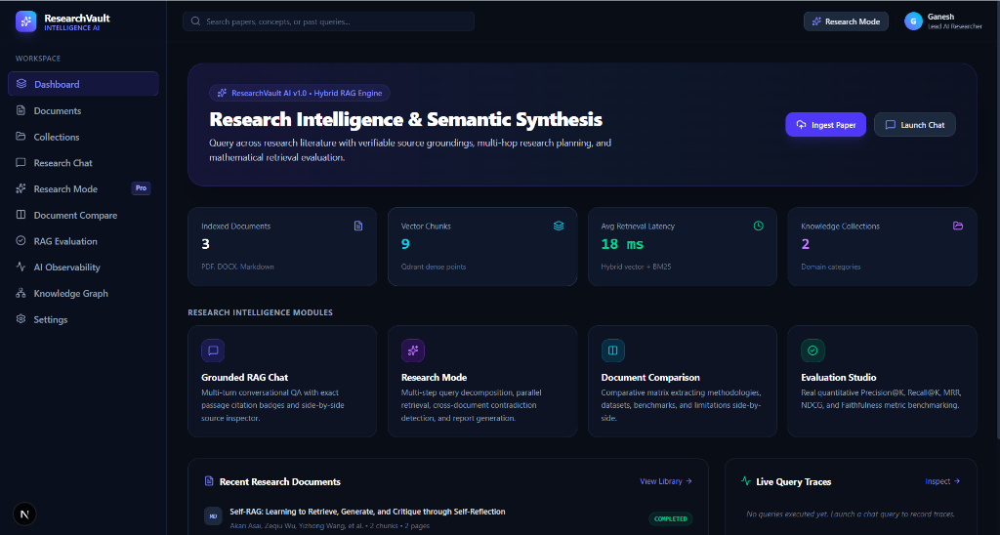
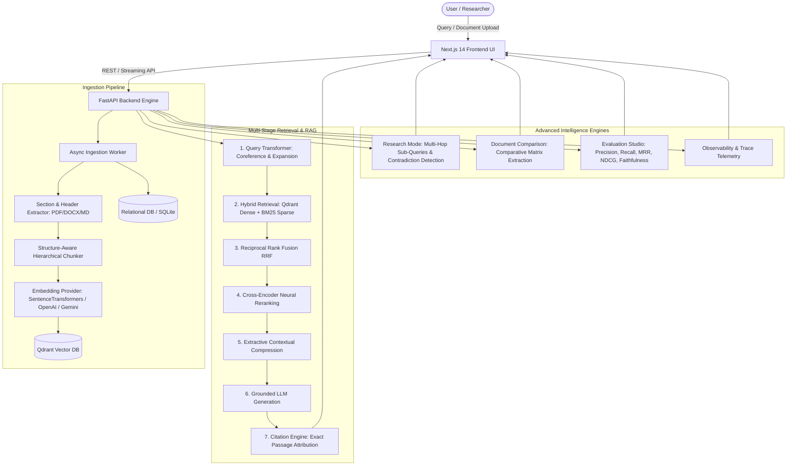
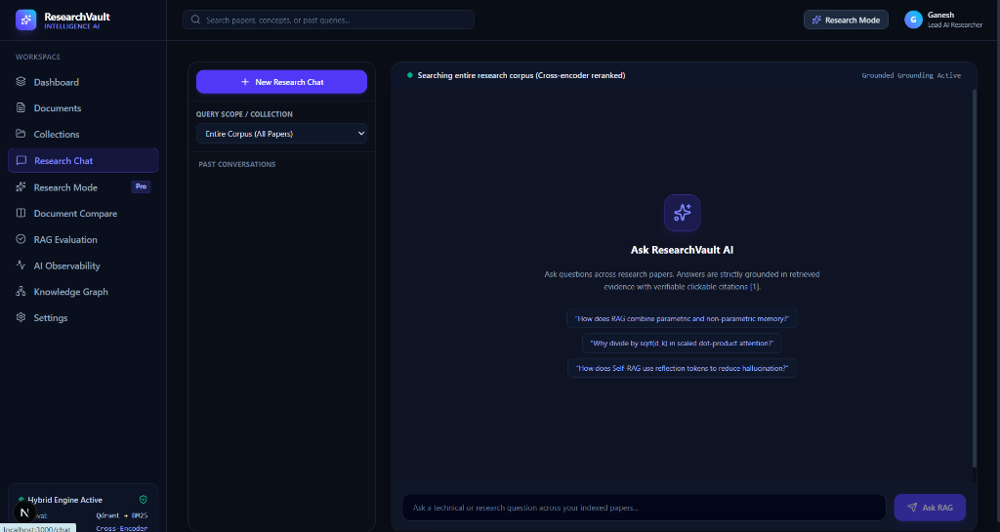
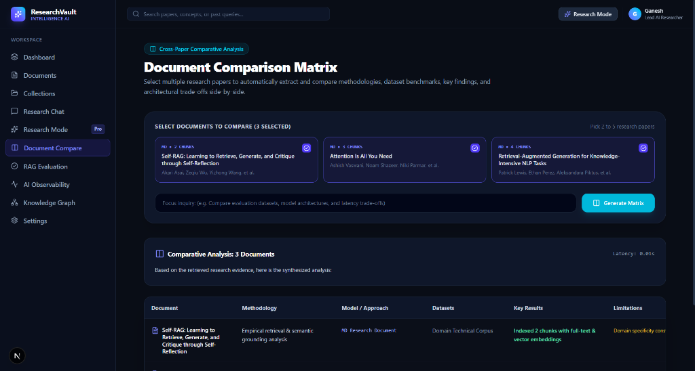

# ResearchVault AI — Research Intelligence & RAG Platform

[](https://python.org)
[](https://fastapi.tiangolo.com)
[](https://nextjs.org)
[](https://qdrant.tech)
[](LICENSE)

**ResearchVault AI** is a production-grade, state-of-the-art **Retrieval-Augmented Generation (RAG)** and Research Intelligence platform engineered for academic literature, technical specifications, and dense documentation. 

Unlike basic "chat with PDF" prototypes that perform naive top-k vector searches and hallucinate page numbers, ResearchVault AI implements a multi-stage hybrid RAG pipeline with coreference resolution, multi-query expansion, Reciprocal Rank Fusion (RRF), neural cross-encoder reranking, extractive contextual compression, verifiable citations `[N]` mapped to exact document passages, autonomous **Research Mode** synthesis, cross-document comparison matrices, and mathematical RAG evaluation (Precision@K, Recall@K, MRR, NDCG@K, and Faithfulness).



---

## 🏛️ System Architecture



---

## 🚀 Key Engineering Features

### 1. Structure-Aware Document Ingestion
- **Multi-Format Extraction**: Parses PDF (PyPDF), DOCX (python-docx), TXT, and Markdown preserving hierarchical headings (`#`, `##`, `###`), page boundaries, and paragraphs.
- **Contextual Chunk Headers**: Every chunk is injected with provenance:  
  `[Document: Attention Is All You Need | Author: Vaswani et al. | Section: 2. Scaled Dot-Product Attention | Page: 3]`  
  drastically improving semantic retrieval and dense embedding clustering.
- **Sliding-Window Overlap**: Sentence-boundary-preserving token sliding window with configurable target chunk size (~500 tokens) and overlap (~100 tokens).

### 2. Multi-Stage Hybrid Retrieval & Reranking
1. **Conversational Query Rewriting**: Coreference resolution rewriting multi-turn conversational follow-ups into standalone semantic search queries.
2. **Multi-Query Expansion**: Decomposes user inquiries into 3–4 expanded search queries across different technical perspectives.
3. **Dense Semantic Search**: Cosine vector similarity search executed in Qdrant with payload metadata filtering (collection, document, author).
4. **Sparse Lexical Search**: BM25 Okapi term frequency matching against relational chunk indices.
5. **Reciprocal Rank Fusion (RRF)**:
   $$\text{RRF\_Score}(d) = \sum_{m \in \{\text{vector}, \text{lexical}\}} \frac{w_m}{k + \text{rank}_m(d)}$$
6. **Cross-Encoder Neural Reranking**: Re-scores top 20–30 hybrid candidates with `cross-encoder/ms-marco-MiniLM-L-6-v2`.
7. **Extractive Contextual Compression**: Extracts high-relevance sentences from chunks, removing boilerplate and reducing prompt token overhead while preserving passage attribution.

### 3. Verifiable Citation Engine & Grounded RAG Chat
- Inline numbered references `[1]`, `[2]` are strictly enforced by the system prompt.
- Clicking any citation badge opens the **Source Inspector Drawer**, highlighting the exact document title, page number, section name, similarity score, rerank score, and supporting passage.



### 4. Deep "Research Mode"
- Autonomous research planning: Decomposes broad topics into 3 targeted sub-questions.
- Executes parallel multi-hop retrievals.
- Synthesizes an extensive academic report:
  - Executive Summary
  - Key Empirical Findings
  - Comparative Synthesis
  - Cross-Document Contradictions & Diverging Perspectives
  - Open Research Gaps

### 5. Multi-Document Comparison Matrix
- Select 2–5 research papers to generate side-by-side comparative matrices:
  - Methodology
  - Architecture / Approach
  - Datasets Evaluated
  - Key Benchmark Results
  - Limitations & Trade-offs
  - Exact row-level citations



### 6. Mathematical RAG Evaluation Studio
Run real benchmarks against gold-standard evaluation datasets and compute actual metrics:
- **Retrieval Metrics**:
  - **Precision@K**: $\frac{|\text{Retrieved@K} \cap \text{Relevant}|}{K}$
  - **Recall@K**: $\frac{|\text{Retrieved@K} \cap \text{Relevant}|}{|\text{Relevant}|}$
  - **Mean Reciprocal Rank (MRR)**: $\frac{1}{\text{rank of first relevant item}}$
  - **NDCG@K**: $\frac{\text{DCG@K}}{\text{IDCG@K}}$ where $\text{DCG@K} = \sum_{i=1}^K \frac{\text{rel}_i}{\log_2(i+1)}$
- **Generation Metrics**:
  - **Faithfulness**: Proportion of generated statements supported by retrieved context.
  - **Answer Relevance**: Key concept overlap between generated response and ground truth.
  - **Context Relevance**: Proportion of retrieved chunks relevant to query intent.
  - **Citation Accuracy**: Proportion of valid citations referencing grounded evidence.

### 7. AI Observability & Query Tracing
- Full step-by-step pipeline debugger displaying:
  - `Raw Query -> Rewritten Query -> Expansion Queries -> Vector Scores -> Lexical Scores -> RRF Candidates -> Reranker Logits -> Compressed Context -> LLM Prompt -> Answer & Citations`
  - Granular latency stage breakdown timing bars (`query_transform_ms`, `retrieval_ms`, `rerank_ms`, `generation_ms`, `total_latency_ms`).
  - Token consumption counters.

---

## 🛠️ Technology Stack

- **Frontend**: Next.js 14 (App Router), TypeScript, Tailwind CSS, Lucide Icons, Recharts, React-Markdown, Remark-GFM.
- **Backend**: Python 3.11+, FastAPI, Uvicorn, SQLAlchemy (Async), Pydantic v2, PyPDF, python-docx.
- **Vector Database**: Qdrant (Supports standalone local embedded storage, in-memory, or remote Qdrant Docker cluster).
- **Embeddings**: SentenceTransformers (`all-MiniLM-L6-v2`), OpenAI (`text-embedding-3-small`), Google Gemini, Ollama, FastNumPy fallback.
- **Reranker**: Cross-Encoder (`ms-marco-MiniLM-L-6-v2`), Heuristic BM25 fallback.
- **Database**: PostgreSQL (Docker) / SQLite (zero-friction local testing).

---

## 🚀 Quick Start Guide

### Option A: Standalone Local Run (Zero External Dependencies)

1. **Clone the repository**:
   ```bash
   git clone https://github.com/your-username/ResearchVaultAi.git
   cd ResearchVaultAi
   ```

2. **Setup Backend**:
   ```bash
   cd backend
   pip install -r requirements.txt
   ```

3. **Start Backend Server**:
   ```bash
   uvicorn researchvault.main:app --host 0.0.0.0 --port 8000 --reload
   ```
   *The backend will automatically create the database, seed sample research papers ("Attention Is All You Need", "Retrieval-Augmented Generation", "Self-RAG"), generate embeddings, index Qdrant vectors, and seed benchmark evaluation datasets.*

4. **Setup & Start Frontend**:
   ```bash
   cd ../frontend
   npm install
   npm run dev
   ```
   *Open [http://localhost:3000](http://localhost:3000) in your browser.*

---

### Option B: Docker Compose (Full Production Cluster)

Run the entire full-stack application (Next.js, FastAPI, PostgreSQL, Qdrant, Redis):

```bash
docker compose up --build
```

Access services:
- **Frontend Web App**: `http://localhost:3000`
- **FastAPI OpenAPI Swagger Docs**: `http://localhost:8000/docs`
- **Qdrant Vector Dashboard**: `http://localhost:6333/dashboard`

---

## 🧪 Running Automated Tests

Run backend unit and integration test suite (covering chunking, embeddings, hybrid retrieval, reranking, citations, and evaluation metrics):

```bash
cd backend
pytest tests/ -v
```

---

## 👤 Author

**Ganesh**  
ResearchVault AI — Research Intelligence & RAG Platform

---

## 📄 License

This project is licensed under the MIT License - see the [LICENSE](LICENSE) file for details.
